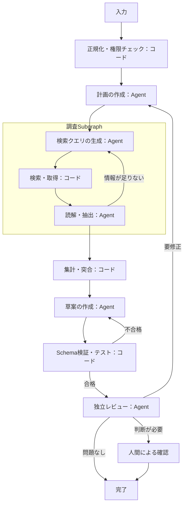
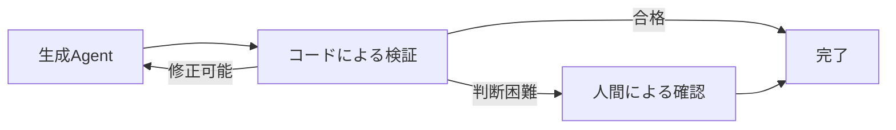

最近、AIエージェント開発の文脈で `Graph Engineering` という言葉を見かけるようになった。

2026年7月には「LoopからGraphへ移ったのか」という議論が実務家の間で注目され、LangGraphを開発するLangChainも、Graph Engineeringをテーマにした記事を公開している。ただし、その記事自身が、AgentシステムをGraphとして表現する考え方は以前から存在しており、Graph Engineeringは新しい名前であって新しい発想ではないと説明している。([langchain.com][1])

当初、私は次のような技術を想像していた。

> 複数のAgentをNodeとして接続すれば、単一のAgent Loopよりも自律性が高まり、人間の手離れも良くなるのではないか。

しかし、関連する研究や実装の歴史を追ってみると、それほど単純な進化関係ではなかった。

Graph Engineeringは、Agentをさらに自由に動かすためだけの考え方ではない。

むしろ、Agent、ツール、コードで規定する処理、検証、人間の判断などを含む複雑なシステムについて、`実行構造そのものを設計・観測・評価・改善の対象として扱う視点`だと考えると理解しやすい。

---

## Graph Engineeringという言葉はまだ定まっていない

`Graph Engineering` という言葉が指す範囲は、現時点では資料によって異なる。今回確認した範囲では、AIエージェント分野における広く合意された定義や標準仕様は見つけられなかった。

LangGraphの開発元であるLangChainは、単一Agentの循環的な処理や、コードで実行経路を規定した処理とAgentによる判断を組み合わせた構造も含めて、AgentシステムをGraphとして表現する考え方を、広い意味でGraph Engineeringと捉えている。([langchain.com][1])

一方、個人が公開したキュレーション資料である `Awesome Graph Engineering` は、Graph Engineeringを新興の非標準用語と明記したうえで、複数の独立したAgent、明示的な協調関係、検査可能なGraph構造を最低条件とする、より狭い作業定義を採用している。([GitHub][2])

ただし、後者は分野全体で合意された定義ではなく、キュレーターが資料を整理するために設定した作業定義である。ここでは、同時期の資料間でもGraph Engineeringが指す対象範囲が一致していない一例として参照している。

今回確認した資料の範囲では、少なくとも次のような点が一致していない。

* 単一Agent内部のGraphを含めるか
* 複数Agentが必須か
* 設計図としてのGraphまで含めるか
* 実行可能なGraphだけを対象とするか
* 固定Graphだけでなく、動的に生成されるGraphも含めるか

そのため、本記事では特定の定義を正解とはせず、次のように広く捉える。

> LLMを含む実行システムの構成要素と関係をGraphとして表し、その構造を設計・実行・観測・評価・改善する実践。

なお、これは業界標準として確立された定義ではなく、本記事の議論を整理するための作業定義である。

---

## 言葉は新しいが、背景にある技術は新しくない

Graph Engineeringという呼称が注目されたのは最近だが、その背景にある技術は段階的に発展してきた。

単純な一本道ではないものの、大まかには次のような関心の広がりとして見ることができる。

```text
単一Agentの思考と行動
        ↓
複数Agentやツールの協調
        ↓
Stateを持つ長時間・循環的な実行
        ↓
実行構造そのものの評価・最適化
```

### Agent Loop

2022年にプレプリントが公開され、ICLR 2023で発表されたReActは、LLMによる推論と外部環境に対する行動を交互に実行する方法を示した。

Agentが状況を観察し、考え、ツールを使い、その結果を再び観察するという、現在のAgent Loopにつながる代表的な研究である。([ICLR 2023][3])

```text
考える
  ↓
行動する
  ↓
結果を観察する
  ↓
再び考える
```

この構造では、次に何をするかの大部分を一つのモデルが判断する。

柔軟性は高い一方で、すべての判断をモデルへ委ねるため、特定の順序を守らせたい場合や、権限、検証、停止条件を厳密に制御したい場合には追加の仕組みが必要になる。

### Multi-Agentの協調

2023年にプレプリントが公開され、COLM 2024で発表されたAutoGenは、LLM、ツール、人間などを組み合わせた複数Agentが、会話を通じて協調するフレームワークを提示した。

固定された対話順序だけでなく、LLMが次に呼ぶAgentを選択する動的な構成も扱っている。([COLM 2024][4])

同じく2023年に公開されたDyLANは、Agentをネットワーク上のNode、Agent間のメッセージをEdgeとして表現し、タスクに応じたAgent選択や早期停止によって、協調構造を動的に変える方法を研究している。([arXiv][5])

この段階になると、問題は個々のAgentの能力だけではなくなる。

* どのAgentを参加させるか
* 誰が誰へ情報を渡すか
* どの順序で処理するか
* どこで合意や検証を行うか
* いつ処理を終了するか

こうしたAgent間の関係も、システム全体の性能を左右する。

### StatefulなGraph Runtime

LangGraphは2024年1月に、Agent Runtimeで必要となる循環的な処理を、共有State、Node、Edgeを持つGraphとして構築するために公開された。

単純なAgent Loopへすべての判断を任せるのではなく、次のような制御を加えやすくすることが、当初からの目的として説明されている。([langchain.com][6])

* 特定のツールを先に呼ばせる
* 出力形式を固定する
* 検証処理を通過させる
* 人間の確認を挟む
* 再試行回数に上限を設ける

ここで重要なのは、Graphが必ずしもDAGではないことだ。

Agentシステムでは、再試行、追加調査、修正、ユーザーへの確認などが必要になる。そのため、実際のGraphには循環が含まれることが多い。

LangChainも、Agent Graphは一般にDAGとは限らず、Loopは循環Graphの単純な形として捉えられると説明している。([langchain.com][1])

### Graph構造そのものの最適化

2024年にICMLで発表されたGPTSwarmは、LLM呼び出しやツール利用をNode、処理や通信の関係をEdgeとして表し、Agentや複数Agentの構成を最適化可能なGraphとして扱った。

Promptだけでなく、Node、Edge、Agent間の接続構造そのものを、進化的手法や強化学習などによって改善する方向性を示している。([ICML 2024][7])

2026年に公開されたWorkflow Optimizationに関するサーベイ（プレプリント）では、LLM呼び出し、検索、ツール利用、コード実行、メモリ更新、検証などを組み合わせたWorkflowを、`Agentic Computation Graph`として統一的に整理している。

そこでは、固定されたGraphだけでなく、次のような仕組みまで研究対象に含まれている。([arXiv][8])

* 実行前にGraphを生成する
* タスクに応じてGraphを選択する
* 実行途中にGraph構造を変更する
* 実行結果に基づいてGraphを改善する

この流れを踏まえると、Graph Engineeringは突然生まれた新技術というより、

> Agent Loop、Multi-Agent協調、Stateful Workflow、Workflow構造の最適化といった流れを、Graphという共通の視点で捉え直す動き

と理解するのが近そうだ。

---

## なぜ今、Graph Engineeringが注目されたのか

初期のAgentでは、一つのモデルがツールを使いながらLoopを回す構成でも、多くのことを試せた。

しかし、Agentシステムが実務へ広がるにつれて、次のような構成要素が増えている。

* LLMによる意味判断
* コードで処理手順や判定条件を規定した処理
* 検索やコード実行などのツール
* 長時間処理のためのStateやMemory
* 専門性の異なるAgent
* 出力を確認するVerifier
* 人間による承認
* 失敗時の再試行やエスカレーション

2026年のWorkflow Optimizationサーベイも、現在のAgentシステムでは、個々のモデル呼び出しだけでなく、`何を、いつ呼び、どのように情報を流すか`というWorkflow構造が、品質と効率の双方へ影響すると整理している。([arXiv][8])

さらに、LangChainは最近の変化として、GraphのNodeに単純なLLM呼び出しだけでなく、独自のLoopを持つAgent全体を配置できるようになったことを挙げている。

つまり、現在は「処理をGraphにする」だけでなく、`自律的に動くAgent同士をGraphとして組み合わせる`ことが現実的な選択肢になりつつある。([langchain.com][1])

この複雑化によって、関心の対象がAgent単体からシステム全体へ広がった。

```text
Agent単体をどう賢くするか
        ↓
Agentや処理をどう組み合わせるか
        ↓
その構造をどう観測・評価・改善するか
```

これが、Graph Engineeringという言葉が今あらためて注目されている背景だと考えられる。

---

## Graph Engineeringの目的をどう捉えるか

Graph Engineeringの目的は、単にNodeやAgentを増やすことではない。

本記事では、次のように捉えている。

> Agentシステムの実行構造を第一級の設計対象とし、Agent、コードで規定する処理、ツール、State、検証、人間判断を、適切な関係と境界で組み合わせること。

概念的には、次のような構成になる。



ここで重要なのは、AgentとコードがGraphの入口で二者択一になっていないことである。

一つのタスクは、正規化、計画、調査、集計、草案、検証、レビューという段階を進む中で、両者を何度も行き来する。Subgraphの内部では、Agentが自分のLoopを回している。

このGraphには、性質の異なる処理が混在している。

* 曖昧な意味判断はLLMへ委ねる
* 手順や判定条件を明示できる処理はコードで実行する
* Agentには必要な範囲だけ自律性を与える
* 重要な処理には検証や人間承認を配置する
* Stateを使って中断、再開、再試行を管理する

戻り先も一つではない。検証で落ちたときは草案へ、レビューで方針が問題だと判断されたときは計画へ戻すというように、失敗の種類に応じて再試行の粒度を変えられる。

Graph Engineeringの価値は、Agentを増やすことよりも、`どこへ、どの程度の自律性を配置するか`をシステム全体で考えられることにある。

---

## Graphを設計対象にすることで期待できること

以下は、Graphを採用すれば自動的に実現する効果ではない。

Graphと実行基盤を適切に設計した場合に、取り組みやすくなることとして整理する。

### システム構造に起因する問題を扱える

Agentシステムの失敗は、個々のPromptやモデル能力だけが原因とは限らない。

例えば、次のような問題が考えられる。

* 必要な情報が後続Agentへ渡らない
* 同じ処理が複数Agentで重複する
* Verifierが必要な場所に存在しない
* 誤ったAgentへタスクが割り当てられる
* 終了条件が不適切で処理が続きすぎる
* 一つのAgentへ権限や責務が集中しすぎる

NeurIPS 2025で発表されたMulti-Agent System Failure Taxonomyの研究では、複数のMulti-Agentフレームワークの実行Traceを分析し、システム設計、Agent間の不整合、タスク検証に関する失敗パターンを分類している。([NeurIPS 2025][9])

このような失敗は、個々のPromptを改善するだけでは解消できない可能性がある。

Graphとして関係を表現すれば、問題をNode単体ではなく、次のような構造から分析できる。

* 情報の経路
* 役割分担
* 検証を配置する位置
* 権限の境界
* 再試行の経路
* 終了条件

### コードで規定する処理とAgentによる判断を組み合わせやすい

AgentシステムのすべてをLLMへ任せる必要はない。

例えば、次の処理は、一般にLLMへ判断させるよりもコードとして実装した方が適している。

* Schema検証
* 数値計算
* ファイル存在確認
* テスト実行
* 権限チェック
* 集計
* 条件判定

これらは、処理手順や合否条件を明示しやすい。

コードとして実装することで、LLMに実行させる場合よりも、一般に次の性質を得やすくなる。

* 低コスト
* 高速
* 再現しやすい
* テストしやすい
* 失敗原因を追跡しやすい
* 入出力条件を明示しやすい

ただし、コードで実装すれば常に正しいわけではない。

実装上の不具合、外部状態への依存、仕様の誤りは発生する。ここでの論点は正しさの保証ではなく、`処理手順と判定条件を明示し、検証可能な形で実装できるか`である。

LangChainも、Graphを利用する価値の一つとして、モデルによる推論が必要な箇所と、コードで処理する箇所を組み合わせられることを挙げている。([langchain.com][1])

Graphとして設計することで、`どこでAgentを使わないか`も明示的に考えやすくなる。

### Stateと責任範囲を明示できる

Nodeごとに、次のような境界を定義できる。

* 何を入力として受け取るか
* 何を変更できるか
* どの情報を共有するか
* どの情報を隔離するか
* 何を出力として残すか
* どのNodeが正式な状態を所有するか

Stateの共有方法は一つではない。

* 共有オブジェクト
* ファイル
* データベース
* 成果物への参照
* 検索可能な外部メモリ

重要なのは、すべてを無条件に共有することではない。

> どの情報を、どのNodeへ、どの粒度で渡すか

を設計することが重要になる。

### 検証や権限制御を構造へ組み込める

Graphには、Agent以外の処理も含められる。

* 自動テスト
* Schema検証
* ルールベースのGate
* 独立Reviewer
* 人間承認
* 予算や実行回数の上限

これらを個別の注意事項としてPromptへ書くだけでなく、実行経路を制約する仕組みとして配置できる。

特に、生成するAgentとは別に検証する処理を置くことで、作成者自身だけを最終評価者にしない構成を作れる。

### Workflow構造そのものを評価・改善できる

Graph Engineeringの特徴的な視点は、個々のAgentやPromptだけでなく、Workflow構造そのものを改善対象にすることだ。

例えば、次のような変更を比較できる。

* Verifierを追加する
* 不要なAgent間通信を削る
* Agentの実行順序を変える
* 一部のLLM Nodeをコード処理へ置き換える
* タスクに応じて使用するSubgraphを変える
* 低価値なAgentを実行時に除外する

2026年のサーベイでは、Workflowを次の3つに分け、品質、コスト、堅牢性、構造変化を評価する枠組みを提示している。([arXiv][8])

* 再利用可能なテンプレート
* 実行ごとに具体化されたGraph
* 実際の実行Trace

つまり、Graphは単なる実装形式ではなく、`測定して改善できる成果物`になり得る。

---

## 過大評価もしない、過小評価もしない

Graph Engineeringを評価するうえでは、両方向の誤解を避ける必要がある。

### Graphにすれば手離れが良くなるわけではない

Graphは実行構造であり、個々のAgentの能力を自動的に高めるものではない。

不適切なAgent、曖昧な責務、弱い検証を接続すれば、失敗が複雑化するだけかもしれない。

LangChainは、汎用的なDeep Researchのように、事前に処理経路を決めにくいタスクの例として、GPT Researcherが定義済みGraphから、計画、委譲、Context管理をAgentへ任せる構成へ移行した事例を紹介している。([langchain.com][1])

Graphは、実行経路を規定して制御を得る場合もあれば、動的なRoutingによって柔軟性を残す場合もある。

どちらが適切かはタスクによって異なる。

### Multi-Agentにすれば品質が上がるわけではない

複数Agentは、専門化、並列化、独立評価などの価値を持ち得る。

一方で、Multi-Agent Systemの性能向上が小さいケースや、次のような失敗も報告されている。([NeurIPS 2025][9])

* Agent間の情報欠落
* 役割からの逸脱
* 重複実行
* 調整コストの増大
* 検証不足

Anthropicが自社のMulti-Agent Researchシステムについて公開した実装報告では、並列調査や単一Context Windowを超える情報量を扱える利点が得られた一方、同社の計測条件では通常のチャットの約15倍のトークンを使用したと述べられている。

また、すべてのAgentが同じContextを必要とするタスクや、Agent間の依存関係が多いタスクには向きにくいとも説明している。([Anthropic][10])

ただし、これは特定のResearchシステムにおける結果であり、Graph Engineering全般のコストを示すものではない。

消費量は、主に次の設計によって変わる。

* LLMを使うNodeの数
* 各Nodeへ渡すContext量
* 再試行回数
* Agent間の通信量
* 評価や統合処理の数
* LLMを使わずコードで処理する範囲

### Contextの分断や膨張は必然ではない

Node間でContextを共有できないわけではない。

共有Stateや外部成果物を使えば、必要な情報を引き継げる。

一方で、すべてのNodeへ大量の情報を渡せば入力が増え、要約しすぎれば必要な背景が失われる可能性がある。

これはGraph固有の欠陥というより、複数の実行単位を持つシステム全般におけるContext設計の問題である。

Anthropicも、大きな成果物をファイルなどへ保存し、Agent間では軽量な参照を渡すことで、情報損失とトークン転送を抑える方法を紹介している。([Anthropic][10])

### 単なるWorkflowの言い換えでもない

Graph、State、Workflow、Multi-Agentといった個々の技術は以前から存在する。

その意味で、Graph Engineeringを完全に新しい技術分野と捉えるのは難しい。

ただし、現在の議論では、次の点が一つの視点としてまとめられている。

* Agent全体をNodeとして扱う
* Agent間の関係を契約として設計する
* 固定構造と動的構造を混在させる
* 実行Traceから構造を評価する
* Graph自体を生成、選択、最適化する

特に、Workflow構造そのものを品質とコストの最適化対象として扱う研究は増えている。([arXiv][8])

したがって、Graph Engineeringを「既存技術の名前を変えただけ」と切り捨てるのも、やや狭い見方になる。

---

## Graph Engineeringを通じて重要性を再認識したこと

Graph Engineeringを調べる中で、Agentシステムを設計するうえで、改めて重要だと感じた考え方がいくつもあった。

いずれも完全に新しいものではなく、ソフトウェア設計、Workflow、分散システム、Agent Engineeringなどで扱われてきた考え方である。

ただ、出力や実行経路が変動しうるAgentと、複数の処理を接続するシステムとして捉え直すことで、その重要性がより具体的に見えてきた。

### 1. 責務と権限を明確にする

各Agentについて、何を担当するかだけでなく、何を担当しないかも定義する。

```yaml
responsibility:
  - 認証・認可の問題を確認する
  - 根拠となるコード位置を示す

out_of_scope:
  - 命名の改善
  - 一般的なリファクタリング

permissions:
  - read
  - search
```

Agentを分離するなら、役割だけでなく、Context、ツール、変更権限、判断権限の境界にも意味が必要になる。

### 2. 入力範囲を明示する

Agentが参照する情報を無制限にしない。

```yaml
inputs:
  required:
    - target-diff
    - acceptance-criteria

  optional:
    - architecture-document

  excluded:
    - unrelated-projects
```

入力範囲を定めることで、不要な探索を減らし、何を根拠に判断したのかも追いやすくなる。

### 3. 出力を契約として扱う

後続処理が利用する出力には、必要な項目を定義する。

```json
{
  "decision": "needs_revision",
  "findings": [
    {
      "severity": "high",
      "claim": "権限確認が不足している",
      "evidence": "src/auth/service.ts:84"
    }
  ],
  "unknowns": [],
  "next_actions": [
    "管理者権限の検証を追加する"
  ]
}
```

必ずしもJSONである必要はない。

人間が読む成果物なら、必須見出しを持つMarkdownテンプレートでもよい。

重要なのは、後続のAgentやコード処理が、出力の意味を毎回推測しなくてよいことである。

### 4. Stateの所有者と保存場所を決める

目的、進捗、判断、根拠、未解決事項を、会話履歴だけに依存させない。

```yaml
goal: 変更内容の安全性を確認する
status: in_progress

completed:
  - authentication-review

remaining:
  - authorization-review

decisions:
  - 管理者操作を追加検証する
```

そのうえで、次の点を定める。

* どの情報が正式なStateか
* どのNodeが更新できるか
* 変更履歴をどこへ残すか
* 複数Nodeの変更をどう統合するか

### 5. 完了条件と停止条件を定義する

Agentには開始条件だけでなく、終了条件も必要になる。

* 何が揃えば完了か
* 何回まで再試行するか
* 進展がない場合にどう停止するか
* どの条件で人間へ判断を戻すか
* どの失敗を許容しないか

Agentの自律性を高めることと、無制限な探索や反復を許すことは別である。

### 6. LLMを使う場所を選ぶ

意味理解、仮説生成、複数の妥当な解釈があり得る評価は、LLMの能力を活かしやすい。

一方で、型検証、計算、テスト、集計、存在確認、権限判定など、処理手順や判定条件を明示できるものは、原則としてコードで処理する方が適している。

```text
意味理解・仮説生成・曖昧な評価
→ LLMによる判断

型検証・計算・テスト・条件判定
→ コードによる処理
```

Nodeを増やす場合、すべてをLLM Nodeにしてしまうと、コストと不確実性も積み重なる。

判断基準は、単に「アルゴリズムで扱えるか」ではない。

> 既存の方法で、必要な品質の結果を、必要な時間とコストで得られるか

を考える必要がある。

コードで実用的に処理できるなら、計算そのものをLLMへ任せる必要性は低い。

一方、処理手順を事前に固定しにくい場合や、意味理解、探索、仮説生成が必要な場合には、LLMを利用する価値が生まれる。

### 7. Agentを分ける理由を明確にする

Agentを分けること自体に価値はない。

次のような理由がある場合に分離を検討する。

* 異なる専門性が必要
* 異なるContextを持たせたい
* 異なるツールや権限を与えたい
* 独立した評価に意味がある
* 並列化による効果が期待できる
* 失敗や影響範囲を局所化したい

理由を説明できなければ、単一AgentのLoopや、Agentを使わないコード処理の方が単純である可能性が高い。

### 8. Agent単体ではなくシステム全体を評価する

個々のAgentの出力だけでなく、次のような指標も見る必要がある。

* どの経路を通ったか
* 何回再試行したか
* どこで失敗したか
* Agent間で何を受け渡したか
* どのNodeがコストを使ったか
* Verifierが何を却下したか
* Graph変更によって品質とコストがどう変わったか

Graph Engineeringで特に再認識したのは、Agentシステムでは、

> 局所的に優秀なAgentを並べること

と、

> 全体として優秀なシステムを作ること

は同じではないという点である。

---

## Graph Engineeringに取り組む価値はあるか

すべてのAgentシステムをGraph化する必要はない。

一方、Graph Engineeringを単なる流行語として無視するのも早いと思う。

次の条件が複数当てはまる場合には、小さなGraphから検証する価値がある。

* 複数の責務や権限境界がある
* 独立した検証や反証が重要
* 並列に処理できる作業がある
* 長時間処理の中断や再開が必要
* 実行経路や判断履歴を追跡したい
* 同じ構造を繰り返し利用する
* 失敗原因がAgent単体ではなく構造にありそう
* 高価値なタスクで、追加コストを正当化できる
* Workflow構造を評価、最適化したい

最初から大規模なMulti-Agent Systemを作る必要はない。

例えば、次の程度でもGraph的な設計を検証できる。



この小さな構成でも、次の論点が現れる。

* Nodeの責務
* 入出力契約
* State管理
* 検証基準
* 再試行回数
* 人間へ戻す条件
* 品質とコストの測定

本番導入は、具体的な課題と費用対効果から判断すべきである。

ただし、技術検証まで問題が起きるのを待つ必要はない。

---

## 現時点での結論

Graph Engineeringという呼称は新しく、今回確認した資料の範囲では、指す対象もまだ定まっていない。

一方、その背景にある次の分野には、すでに一定の研究と実装の蓄積がある。

* Agent Loop
* Multi-Agent協調
* Stateful Workflow
* Graph型Runtime
* Workflow Optimization

そのため、Graph Engineeringを、

> Loop Engineeringの次に来る万能な自律化手法

と捉えるのは適切ではなさそうだ。

LoopとGraphは単純な成熟段階ではなく、扱う問題の範囲が異なる。

* Loopは、一つの実行主体が時間軸上でどう反復するかを扱う
* Graphは、複数の処理や実行主体がどう関係するかを扱う
* 実際のAgentシステムでは、GraphのNode内部でLoopが動く

一方で、Graph Engineeringを既存Workflowの単なる言い換えとして扱うのも不十分である。

現在のGraph Engineeringに関する議論では、Agentを含むWorkflow構造そのものを、設計、観測、評価、生成、最適化の対象として扱う視点が強まっている。

Graphを採用すれば、Agentシステムが自動的に賢く、安全に、安価になるわけではない。

それでも、Agent単体だけでなく、Agent同士の関係、State、権限、検証、コストまで含めてシステムを設計する視点には、十分に取り組む価値がある。

> Graphを作ることを目的にするのではなく、Agentシステムの構造を、どこまで明示・測定・改善する必要があるかを考える。

Graph Engineeringから得た最も重要な示唆は、この問いそのものだと感じている。

---

## 参考リンク

情報源によって検証のされ方が異なるため、種別を併記する。

| 参考資料 | 種別 | 記事内での用途 |
| - | - | - |
| [3 Years of Graph Engineering with LangGraph](https://www.langchain.com/blog/3-years-of-graph-engineering-with-langgraph) | 企業公式ブログ | LangGraph開発元による広義の概念整理 |
| [LangGraph](https://www.langchain.com/blog/langgraph) | 企業公式ブログ | Graph型Runtimeの設計目的 |
| [Awesome Graph Engineering - Working Definition](https://github.com/ChaoYue0307/awesome-graph-engineering/blob/main/DEFINITION.md) | 個人キュレーション資料 | 狭義の作業定義の一例と関連資料の探索 |
| [ReAct: Synergizing Reasoning and Acting in Language Models](https://openreview.net/forum?id=WE_vluYUL-X)（ICLR 2023 / [arXiv](https://arxiv.org/abs/2210.03629)） | 査読論文 | ReasoningとActionを組み合わせる基本概念 |
| [AutoGen: Enabling Next-Gen LLM Applications via Multi-Agent Conversation](https://www.microsoft.com/en-us/research/publication/autogen-enabling-next-gen-llm-applications-via-multi-agent-conversation-framework/)（COLM 2024 / [arXiv](https://arxiv.org/abs/2308.08155)） | 査読論文・企業公式資料 | 複数Agentによる協調実装 |
| [A Dynamic LLM-Powered Agent Network for Task-Oriented Agent Collaboration（DyLAN）](https://arxiv.org/abs/2310.02170) | プレプリント | 協調構造を動的に変える研究 |
| [GPTSwarm: Language Agents as Optimizable Graphs](https://proceedings.mlr.press/v235/zhuge24a.html)（ICML 2024 / [arXiv](https://arxiv.org/abs/2402.16823)） | 査読論文 | Agent間構造をGraphとして最適化する研究 |
| [From Static Templates to Dynamic Runtime Graphs: A Survey of Workflow Optimization for LLM Agents](https://arxiv.org/abs/2603.22386) | プレプリント | Workflow最適化という研究領域全体の整理 |
| [How we built our multi-agent research system](https://www.anthropic.com/engineering/multi-agent-research-system) | 企業公式ブログ | 実運用に近いMulti-Agent構成の実装報告 |
| [Why Do Multi-Agent LLM Systems Fail?](https://proceedings.neurips.cc/paper_files/paper/2025/hash/b1041e52d3be19f0a9bc491657488e4a-Abstract-Datasets_and_Benchmarks_Track.html)（NeurIPS 2025 / [arXiv](https://arxiv.org/abs/2503.13657)） | 査読論文 | Multi-Agentシステムの失敗要因 |

[1]: https://www.langchain.com/blog/3-years-of-graph-engineering-with-langgraph "3 Years of Graph Engineering with LangGraph"
[2]: https://github.com/ChaoYue0307/awesome-graph-engineering/blob/main/DEFINITION.md "awesome-graph-engineering/DEFINITION.md at main · ChaoYue0307/awesome-graph-engineering · GitHub"
[3]: https://openreview.net/forum?id=WE_vluYUL-X "ReAct: Synergizing Reasoning and Acting in Language Models (ICLR 2023)"
[4]: https://www.microsoft.com/en-us/research/publication/autogen-enabling-next-gen-llm-applications-via-multi-agent-conversation-framework/ "AutoGen: Enabling Next-Gen LLM Applications via Multi-Agent Conversation (COLM 2024)"
[5]: https://arxiv.org/abs/2310.02170 "Dynamic LLM-Agent Network: An LLM-agent Collaboration Framework with Agent Team Optimization"
[6]: https://www.langchain.com/blog/langgraph "LangGraph"
[7]: https://proceedings.mlr.press/v235/zhuge24a.html "GPTSwarm: Language Agents as Optimizable Graphs (ICML 2024)"
[8]: https://arxiv.org/abs/2603.22386 "From Static Templates to Dynamic Runtime Graphs: A Survey of Workflow Optimization for LLM Agents"
[9]: https://proceedings.neurips.cc/paper_files/paper/2025/hash/b1041e52d3be19f0a9bc491657488e4a-Abstract-Datasets_and_Benchmarks_Track.html "Why Do Multi-Agent LLM Systems Fail? (NeurIPS 2025 Datasets and Benchmarks Track)"
[10]: https://www.anthropic.com/engineering/multi-agent-research-system "How we built our multi-agent research system \ Anthropic"
